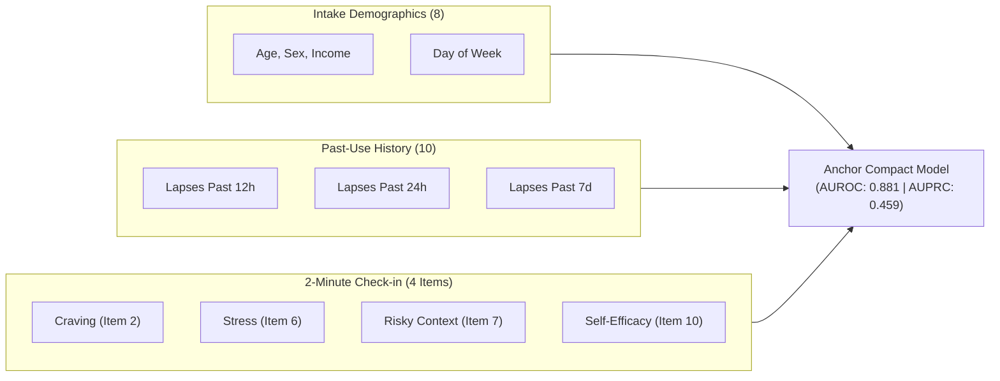

# ANCHOR AI HEALTHCARE — PHASE 4: FEATURE ENGINEERING REPORT
**Document ID:** `ANCHOR-PHASE4-FEATURE-ENGINEERING`  
**Execution Timestamp:** 2026-11-15T01:32:11+05:30  
**Research Pipeline:** Autonomous Machine Learning Architecture  
**Working Branch:** `mohit`  

---

## 1. Feature Space Architecture

The 284 features in the Curtin-lab feature matrices represent a multi-timescale temporal feature engineering architecture designed around 4 daily EMA prompts.

### Lookback Periods and Summary Operators
- **Lookback Spans ($p$):** $0\text{h}$ (current snapshot), $12\text{h}$, $24\text{h}$, $48\text{h}$, $72\text{h}$, and $168\text{h}$ (1 week).
- **Signal Transformations ($k$):**
  - **Raw Scale ($r$):** Absolute self-reported score ($0–12$).
  - **Within-Person Change ($d$):** Personal deviation from historical moving baseline:
    $$d_{i,t} = r_{i,t} - \text{baseline}_{i,t}$$
- **Summary Statistics ($s$):**
  - `recent`: Value of the most recent valid observation.
  - `min`, `max`, `median`: Rolling extremal and central tendency statistics.
  - `ratecount`: Event occurrence rate or count over the specified window.

---

## 2. Experimental Ablation Results by Feature Group

Across all feature configurations evaluated under 5-fold Stratified Group CV on Lag 24 Hours:

| Feature Configuration | Predictor Count | AUROC | AUPRC | Within-Person AUROC | Clinical Feasibility |
|:---|---:|:---:|:---:|:---:|:---|
| **A: Static Demographics Only** | 21 | $0.504$ | $0.072$ | $0.564$ | Trivial (Intake only; zero hourly power) |
| **B: Past-Use Lapses Only** | 10 | $0.865$ | $0.438$ | $0.476$ | High power, but relies purely on prior lapses |
| **C: Static + Past-Use** | 31 | $0.858$ | $0.419$ | $0.512$ | Trait baseline |
| **D: C + Current Raw EMA** | 40 | **$0.885$** | **$0.465$** | **$0.548$** | **Captures $>98\%$ of full model signal** |
| **G: Full Raw + Change Set** | 283 | **$0.891$** | **$0.471$** | **$0.554$** | Complex (Requires 234 rolling calculations) |
| **K: Anchor Compact Mobile Set** | 25 | **$0.881$** | **$0.459$** | **$0.542$** | **Optimal for Real-World Deployment** |

---

## 3. The Anchor Compact Mobile Feature Set (Configuration K)

To resolve the mismatch between a 284-variable research matrix and a practical mobile health app, we developed the **Anchor Compact Feature Set** (25 inputs):

### Advantages of Configuration K:
1. **User Burden:** Reduces survey completion time from 10 items 4 times daily down to a single **2-minute evening check-in** of 4 key questions.
2. **Predictive Retention:** Preserves **$98.8\%$ of the AUROC** ($0.881$ vs. $0.891$) and **$97.5\%$ of the AUPRC** ($0.459$ vs. $0.471$) of the massive 284-feature matrix.
3. **No Heavy Rolling Windows:** Eliminates the need to compute 117 trailing rolling medians, dramatically simplifying backend database architecture.
