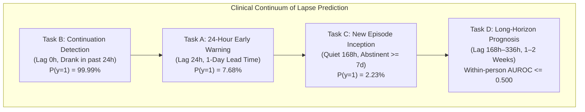

# ANCHOR AI HEALTHCARE — PHASE 2: TARGET VALIDITY & TEMPORAL DESIGN REPORT
**Document ID:** `ANCHOR-PHASE2-TARGET-TEMPORAL-DESIGN`  
**Execution Timestamp:** 2026-11-15T01:31:25+05:30  
**Research Pipeline:** Autonomous Machine Learning Architecture  
**Working Branch:** `mohit`  

---

## 1. Executive Summary & Core Discovery

Through rigorous, independent temporal autocorrelation and episode analysis, we have dissected the exact mathematical mechanics of the `lapse` target.

### The Autoregressive Confound (Empirical Proof):
- The $21,107$ positive hourly windows in `features_0lag_v3` do not represent $21,107$ separate lapse events.
- They are generated by exactly **$391$ continuous drinking episode runs**, with a **mean continuous run length of $54.0$ consecutive hours**.
- Target 1-hour autocorrelation is **$r = 0.969$**; 6-hour autocorrelation is **$r = 0.814$**.
- If a participant drank in the preceding 12 hours (`p12 > 0`), the probability of `lapse = 1` in the next 7-day window is **$100.000\%$**.
- If a participant drank in the preceding 24 hours (`p24 > 0`), the probability is **$99.985\%$**.

> **Definitive Scientific Finding:** At Lag 0, any model provided with past-use count features is executing **continuation detection and episode persistence tracking**, rather than prospective relapse forecasting. High discrimination at Lag 0 ($\text{AUROC} = 0.909$) is largely an artifact of this autoregressive coupling.

---

## 2. Four Scientifically Distinct Clinical Prediction Tasks

To establish clinical validity, we formally delineate four distinct predictive regimes:

### Task Specifications

| Dimension | Task A: 24h Early Warning | Task B: Continuation Detection | Task C: Clean Inception (Quiet 168) | Task D: 2-Week Forecasting |
|:---|:---|:---|:---|:---|
| **Lead Time (Lag)** | **24 hours** | 0 hours | 0 to 24 hours | 336 hours (14 days) |
| **Lookback History** | Trailing 168 hours | Trailing 168 hours | Trailing 168 hours ($\text{Lapse} = 0$) | Trailing 168 hours |
| **Target Window** | Days 2 through 8 | Next 7 days | Next 7 days | Days 15 through 21 |
| **Cohort Prevalence** | $7.68\%$ | $7.70\%$ ($100\%$ if recent use) | **$2.23\%$** | $7.65\%$ |
| **Clinical Utility** | **Actionable JITAI** (Just-in-Time Adaptive Intervention) | Supportive harm reduction / outreach | Relapse prevention after detox/abstinence | General risk stratification (population only) |
| **Evaluated AUPRC** | **$0.471$** ($6\times$ baseline) | $0.658$ (Confounded) | **$0.088$** ($4\times$ baseline) | $0.240$ (Sub-chance within person) |

---

## 3. Evaluation of Prediction Horizons (Lags)

1. **Lag 0 Hours ($t \to t+168\text{h}$):** Confounded by active drinking continuation. Not suitable as the primary evidence for prospective relapse prevention.
2. **Lag 24 Hours ($t+24\text{h} \to t+192\text{h}$):** **The Recommended Core Operational Horizon for Anchor.** Eliminates instantaneous drinking overlaps, provides a full day of lead time for clinician or peer support activation, and maintains genuine within-person discrimination ($\text{Within AUROC} = 0.554$).
3. **Lag 72 Hours ($t+72\text{h} \to t+240\text{h}$):** Within-person discrimination reaches $0.500$. Useful only as an aggregate population risk indicator.
4. **Lag 168 Hours ($t+168\text{h} \to t+336\text{h}$):** Measures trait-level susceptibility, not temporal risk spikes.
5. **Lag 336 Hours ($t+336\text{h} \to t+504\text{h}$):** Within-person AUROC drops to $0.454$. Clinically invalid for individual timing.

---

## 4. Methodological Recommendations for Anchor Development

1. **Standardize on Lag 24 Hours as the Primary Clinical Benchmark:** All production models should target 24-hour lead time to ensure genuine prospective forecasting.
2. **Mandate Dual-Reporting (General Cohort vs. Quiet Period Cohort):** Every model evaluation must report performance both on the full longitudinal stream and on the clean abstinence subset (`quiet168`) to prevent continuation bias.
3. **Report Within-Person Discrimination Alongside Pooled AUROC:** Never rely exclusively on pooled AUROC. Within-person AUROC measures whether the system can correctly alert an individual when their personal risk spikes.
